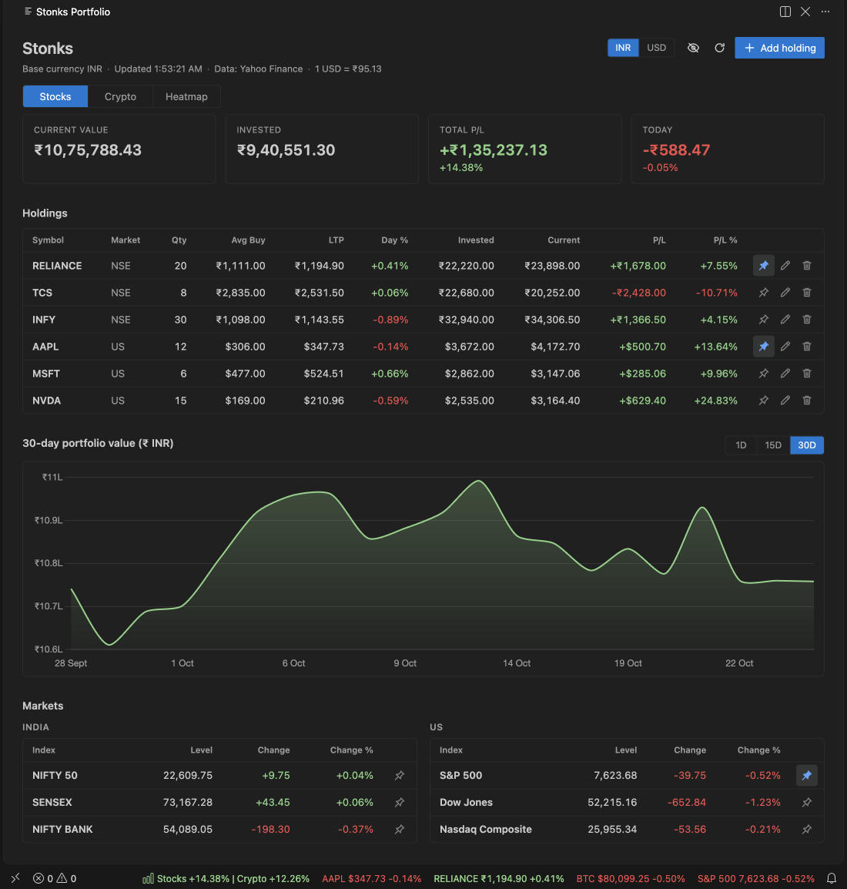
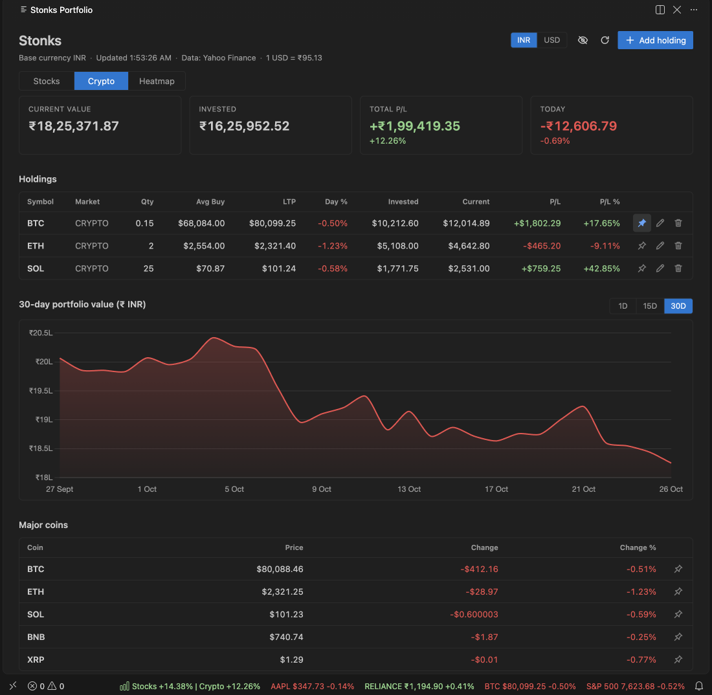
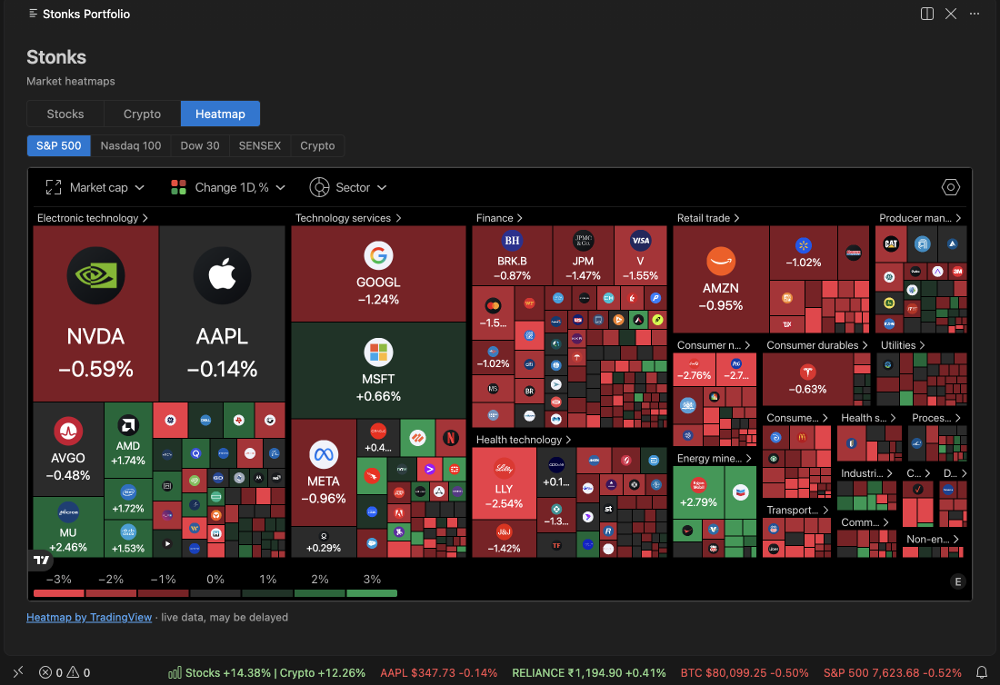
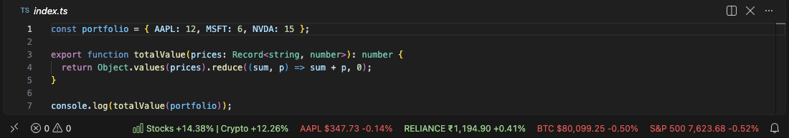

# Stonks Watch

[](https://marketplace.visualstudio.com/items?itemName=venkateshkamat.stonks-watch)
[](https://open-vsx.org/extension/venkateshkamat/stonks-watch)
[](https://github.com/Venkateshkamat/stonks-extension/releases/latest)
[](LICENSE)

> Your stock and crypto portfolio in the status bar, one click from a full panel. Indian and US stocks, crypto, light on CPU and network.



## What it does

- **Status bar profit/loss.** One number for your total profit or loss since purchase: `Stocks +4.21% | Crypto -1.30%` when you hold both.
- **Pinned tickers.** Pin holdings, indices and coins to the status bar: `AAPL $231.40 +0.67%`.
- **Portfolio panel.** Switch between **Stocks**, **Crypto** and **Heatmap**. Each portfolio view has its own totals, holdings table, 1D / 15D / 30D value chart and a Markets table, plus an INR / USD toggle.
- **Market heatmaps.** TradingView heatmaps for the S&P 500, Nasdaq 100, Dow 30, SENSEX and crypto.
- **Holdings on NSE, BSE, US markets and crypto.** Each has a quantity, a buy price and an optional buy date.
- **Hide amounts mode.** Shows percentages only, for screen sharing.
- **Quiet by design.** Closed markets are not refreshed, an unfocused window refreshes less often, and all your windows share one fetch. See [Performance](#performance).
- Works in VS Code and Cursor.







The screenshots use made-up holdings.

## Getting started

1. Run **Stonks: Add Holding** from the command palette (or click the status bar item, then **Add holding**).
2. Pick a market, type a symbol, a quantity and your buy price. The buy date is optional.
3. Click the status bar item to open the portfolio. Pin tickers with the pin button next to a row, or with **Stonks: Pin Ticker to Status Bar**.

Optionally add a free [Finnhub](https://finnhub.io/register) API key with **Stonks: Set Finnhub API Key** (see [Data sources](#data-sources)).

## Markets

| Market | Symbol examples | Currency | Quotes from |
| --- | --- | --- | --- |
| NSE | `RELIANCE`, `TCS`, `INFY` | INR | Yahoo Finance |
| BSE | `RELIANCE`, `TCS` | INR | Yahoo Finance |
| US | `AAPL`, `MSFT`, `BRK.B` | USD | Finnhub (with a key), otherwise Yahoo Finance |
| Crypto | `BTC`, `ETH`, `SOL` | USD | Finnhub (with a key), otherwise Yahoo Finance |

Type the bare symbol: the exchange suffix (`.NS`, `.BO`, `-USD`) is added for you, and typing it yourself is fine. Totals are shown in INR or USD (**Stonks: Set Base Currency**), converted with the live USDINR rate.

The Markets table lists the NIFTY 50, SENSEX, NIFTY BANK, S&P 500, Dow Jones and Nasdaq Composite indices in the Stocks view, and BTC, ETH, SOL, BNB and XRP in the Crypto view.

## Data sources

| What | Source |
| --- | --- |
| NSE and BSE quotes, all history charts, indices, coins table, USDINR rate | Yahoo Finance |
| US and crypto quotes | Finnhub when you add a free API key, with Yahoo Finance as the fallback for any symbol Finnhub cannot serve |
| Heatmap view | TradingView widgets |

The Finnhub key is optional. Without it, everything works from Yahoo Finance. The free Finnhub tier covers US stocks and crypto only, so NSE and BSE always use Yahoo. Heatmaps are a TradingView widget and load only while the Heatmap view is showing. TradingView has no NIFTY heatmap, so SENSEX is the India heatmap.

## Commands

All commands are in the command palette under **Stonks**.

| Command | What it does |
| --- | --- |
| Open Portfolio | Opens (or reveals) the portfolio panel. |
| Add Holding | Adds a holding. |
| Edit Holding | Changes a holding's quantity, buy price or buy date. |
| Remove Holding | Removes a holding. |
| Toggle Hide Amounts | Shows percentages only. |
| Set Base Currency | Totals in INR or USD. |
| Set Refresh Interval | How often quotes refresh. |
| Pin Ticker to Status Bar | Pins a holding, index or coin. |
| Unpin Ticker from Status Bar | Removes a pin. |
| Refresh | Fetches fresh quotes now. |
| Set Finnhub API Key | Stores your free Finnhub key. |
| Clear Finnhub API Key | Removes the stored key. |

## Settings

| Setting | Default | Meaning |
| --- | --- | --- |
| `stonks.baseCurrency` | `INR` | Currency for portfolio totals: `INR` or `USD`. |
| `stonks.refreshIntervalSeconds` | `60` | Seconds between quote refreshes (minimum 15). Closed markets are not refreshed, and an unfocused window refreshes 5 times less often. |
| `stonks.hideAmounts` | `false` | Hide quantities, prices and amounts; only percentages are shown. |

## Closed markets

Quotes are refreshed only while a market is open: NSE and BSE from 09:15 to 15:30 IST, US markets from 09:30 to 16:00 Eastern time (daylight saving is handled), weekdays only. After the close the last close stays on screen, and the status bar tooltip says "Market closed". Crypto refreshes around the clock.

There is no exchange holiday calendar: on a holiday the market is treated as an open day, so quotes are simply fetched as usual (and are unchanged).

## Performance

The extension is built to cost almost nothing while you work:

- **Closed markets are skipped.** One last fetch after the close captures the final price; after that, nothing is requested until the next open.
- **Unfocused windows refresh 5 times less often**, and refresh at once when you come back if the data is stale.
- **Windows share one quote cache**, so several editor windows make one request, not one each.
- **No timers when there is nothing to fetch.** A single wake-up is scheduled for the next market open.
- **Fast start.** The status bar shows the cached numbers about 14 ms after startup, before any network request.

In a simulation of a sample portfolio (3 NSE stocks, 3 US stocks, 2 coins and 2 pinned tickers, refreshing every 60 seconds), requests per day on a weekday fall by about 63% (15,851 to 5,916), and on a Saturday by about 82% (to 2,821). A stocks-only portfolio on a weekend makes about 9 requests a day.

## Privacy

- Your holdings and pins are stored on your machine in the editor's own extension state. If you use the editor's Settings Sync, holdings and pins are synced with it, like other extension data.
- The Finnhub API key is kept in the editor's secret storage (SecretStorage), never in settings or files.
- A small cache of public market quotes is kept in the extension's storage folder so windows can share it. It does not contain your holdings.
- No telemetry and no account. The extension contacts only these hosts: `query1.finance.yahoo.com` (quotes and charts), `finnhub.io` (only if you add a key; the key is sent to it as the API token) and, only while the Heatmap view is showing, TradingView (`s3.tradingview.com`, `www.tradingview-widget.com`, `s.tradingview.com`).

## Known limitations

- Yahoo Finance data comes from an unofficial API. It can change or rate-limit without notice; the extension backs off after an HTTP 429 reply.
- Quotes can be delayed or wrong. Do not trade on them.
- BSE history is sometimes too sparse; the charts then use the NSE listing of the same company.
- There is no NIFTY heatmap (TradingView has none), only SENSEX for India.
- No exchange holiday calendar (see [Closed markets](#closed-markets)).

## Development

```sh
npm ci
npm run compile          # typecheck and bundle to dist/
npm test                 # unit tests (plain Node, no editor needed)
npm run test:integration         # in VS Code (macOS, /Applications)
npm run test:integration:cursor  # in Cursor (macOS, /Applications)
npm run vsix             # builds stonks-watch-<version>.vsix
```

Press F5 in VS Code or Cursor to launch an Extension Development Host. `npm run icon` regenerates `media/icon.png`.

## Releasing

Publishing is automatic: creating a GitHub release publishes the extension to the VS Code Marketplace and to Open VSX (for Cursor), and attaches the `.vsix` to the release.

1. Bump `version` in `package.json` and add a `CHANGELOG.md` entry; run all the tests locally, including `npm run test:integration` and `npm run test:integration:cursor` (CI runs only the unit tests); push to `main`.
2. Create a GitHub release with the tag `vX.Y.Z` (it must match `version`). Pre-releases are skipped and publish nothing.
3. If a store failed (outage, expired token), fix it and re-run: Actions, Publish, "Run workflow" with the tag. A version a store already has is skipped.

Needs two repository secrets (Settings, Secrets and variables, Actions): `VSCE_PAT` (Marketplace token) and `OVSX_PAT` (Open VSX token). The Open VSX namespace must exist once (`npx ovsx create-namespace <publisher> -p <token>`).

## Disclaimer

Market data is provided by Yahoo Finance, Finnhub and TradingView and may be delayed or inaccurate. Stonks Watch is not financial advice.

## License

MIT, see [LICENSE](LICENSE).

## Compatibility


